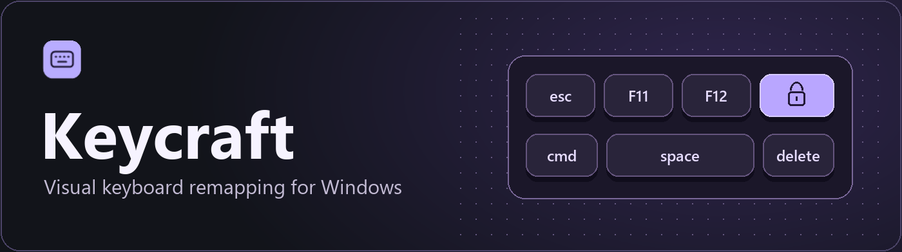
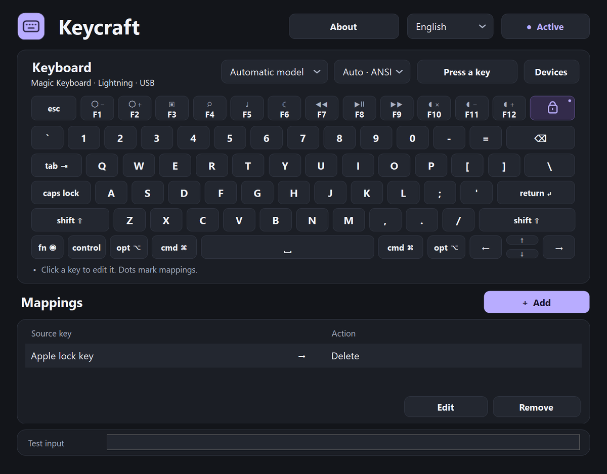

<p align="center">
  
</p>
<p align="center">
  <a href="https://github.com/pilyu9in/Keycraft/releases/latest/download/Keycraft-Portable-win-x64.exe"></a>
</p>
<p align="center">Windows 10 or 11 · x64 · Single executable · No Keycraft installer or separate .NET download</p>

## Make your keyboard work your way

Click a key on the visual layout or use **Press a key** to capture a key or shortcut. Save a mapping to send a different key, send a shortcut, open an app, or run a command you enter. Close the window to keep your mappings active in the system tray. Choose **Exit** from the tray menu to stop remapping.

<p align="center">
  
</p>

| Feature | What you can do |
| --- | --- |
| Visual layouts | Choose compact or full-size Apple layouts in ANSI, ISO, or JIS. Automatic detection covers many Magic Keyboard, Apple Keyboard, and Apple Wireless Keyboard models. |
| Shortcuts and actions | Trigger a mapping with a key or key combination. Send keystrokes, open an app or shortcut, or run a local command. |
| Apple special keys | Assign supported Lock, Fn, and media keys. Availability depends on the keyboard and its connection. |
| Eight languages | English, Russian, German, French, Spanish, Japanese, Simplified Chinese, and Traditional Chinese. |

## Run the portable release

1. [Download `Keycraft-Portable-win-x64.exe`](https://github.com/pilyu9in/Keycraft/releases/latest/download/Keycraft-Portable-win-x64.exe) and run it from any folder. The .NET runtime is bundled.
2. Approve the Windows administrator prompt for the portable release. For the **Lock** and **Fn** keys on a Magic Keyboard **A2450**, connect it by USB and install [USBPcap](https://github.com/desowin/usbpcap) separately. Standard remapping works without that driver.
3. Pick a key, choose an action, and select **Save**. Use **Test input** to try the mapping before switching apps.

Keycraft stores settings under `%LOCALAPPDATA%\Keycraft`. The [release page](https://github.com/pilyu9in/Keycraft/releases/latest) includes the executable and its SHA-256 checksum. The executable is unsigned. See the [bundled .NET license and notices](docs/dotnet-notices.txt).

## Source and data handling

This repository contains the UI, keyboard layouts, Windows input handling, the remapping engine, action launcher, and translations. The downloadable build also includes a private Apple USB input module for extra keys that some keyboards do not expose to Windows. That module is outside the scope of this repository, so reviewing or building the public code covers the source available here.

The public code processes key events locally and persists mappings and preferences. It has no telemetry or keystroke log. Application and command mappings run locally when their assigned keys are pressed. You can review the [remapping engine](src/Keycraft/Remapper.cs) and the [action launcher](src/Keycraft/LaunchAction.cs) directly.

Build and run the public version on Windows with the [.NET 8 SDK](https://dotnet.microsoft.com/en-us/download/dotnet/8.0). It handles regular key mappings and special keys that Windows reports directly.

```powershell
dotnet run --project src/Keycraft/Keycraft.csproj -c Release
```

© 2026 [pilyu9in](https://github.com/pilyu9in). All rights reserved. See [COPYRIGHT.txt](COPYRIGHT.txt).
